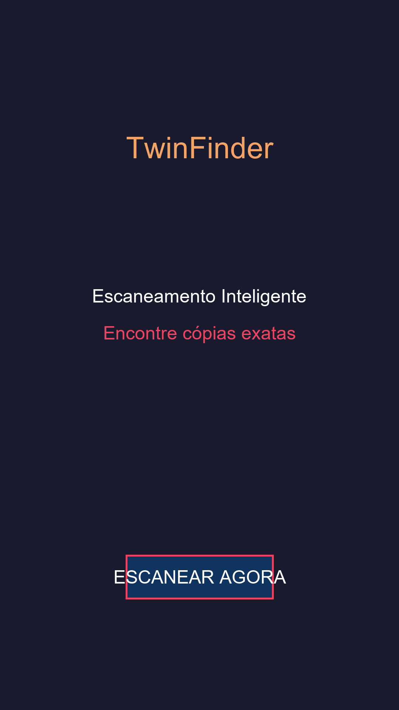
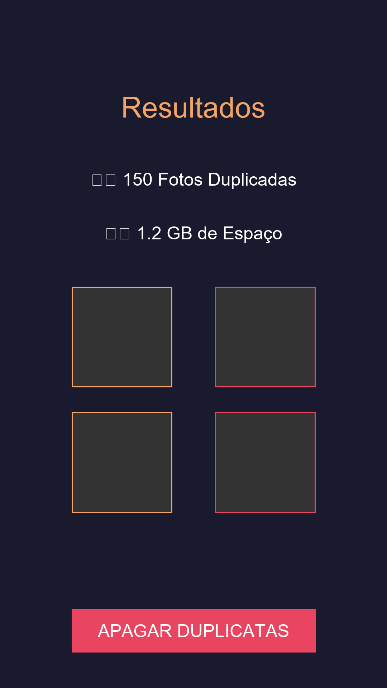
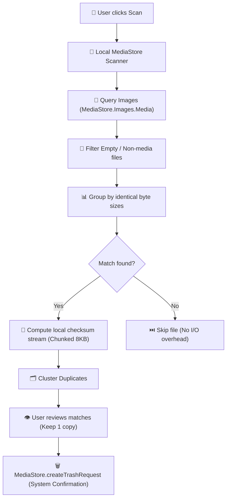

<div align="center">


# 📱 Argos-Android (TwinFinder)
### Native, Offline & Privacy-First Duplicate Media Cleaner for Android

[-3DDC84.svg?logo=android&logoColor=white)](https://android.com)
[](https://kotlinlang.org)
[](https://github.com/Kaio-Comk/Argos-Android)
[](https://developer.android.com/training/data-storage)
[](https://opensource.org/licenses/MIT)

<p align="center">
  
</p>

**Reclaim gigabytes of phone storage instantly by identifying identical duplicate photos and videos directly on your device.**  
*Zero network calls. Zero third-party trackers. Zero cloud uploads.*

[Features](#-key-features) • [Screenshots](#-screenshots) • [Architecture](#-how-it-works) • [Installation](#-installation) • [Privacy Policy](#-privacy--security) • [Contributing](#-contributing)

</div>

---

## 🌟 Key Features

* **⚡ Ultra-Fast Local Scanning:** Scans your gallery via the modern Android `MediaStore` content provider without freezing the UI.
* **🔒 100% Offline & Private:** Requires **NO internet permission** (`android.permission.INTERNET` is not even requested in the manifest). Your private photos and videos never leave your device.
* **🛡️ Safe Android Trash Integration:** Uses Android's native scoped storage trash request (`createTrashRequest`). Duplicate files can be restored anytime from your device's native Gallery Trash/Recycle bin.
* **🎯 Byte-Exact Content Verification:** Avoids false positives by verifying file size before streaming data into hardware-accelerated local hashes.
* **📱 Modern Android Standards:** Built targeting Android 14+ (API 34/36) while supporting devices back to Android 8.0 Oreo (API 26).

---

> [!NOTE]
> **Branding & Identity:** **Argos-Android** is the open-source repository name. **TwinFinder** is the application name and binary distribution (`Argos-v1.0.0.apk` / `TwinFinder.apk`).

---

## 📸 Screenshots

<p align="center">
  
  &nbsp;&nbsp;&nbsp;&nbsp;
  
</p>

---

## 🏗️ How It Works



---

## 🚀 Installation & Download

### Option 1: Direct APK Download
Download the latest pre-compiled signed APK from the [Releases](https://github.com/Kaio-Comk/Argos-Android/releases/latest) section:
1. Download `Argos-v1.0.0.apk` from the latest release.
2. Open the file on your Android smartphone.
3. Allow installation from unknown sources if prompted.
4. Launch **TwinFinder** and grant gallery read access.

### Option 2: Build from Source
Ensure you have the **Android SDK** (API 34+) and **JDK 17+** configured:

```bash
# 1. Clone the repository
git clone https://github.com/Kaio-Comk/Argos-Android.git
cd Argos-Android

# 2. Build debug APK
./gradlew assembleDebug

# 3. Install directly to a connected device or emulator
adb install app/build/outputs/apk/debug/app-debug.apk
```

---

## 🔒 Privacy & Security

Argos was built from day one with a strict **Privacy-First** architecture:
* **No Telemetry / No Analytics:** No Firebase, no Sentry, no Google Analytics, no Facebook SDK.
* **No Remote Communications:** No network stack. The app physically cannot send data over the internet.
* **Scoped Storage Compliant:** Strictly respects modern Android permission models (`READ_MEDIA_IMAGES`, `READ_MEDIA_VIDEO`).
* Official Privacy Policy document is available at [docs/index.html](docs/index.html).

---

## 💻 Companion Desktop App

Looking for a desktop version for Windows with perceptual hash support (`dHash`) and video frame fingerprinting?  
Check out the companion project: **[Argos-Cleaner for Windows (Python / Tkinter)](https://github.com/Kaio-Comk/Argos-Cleaner)**.

---

## 🤝 Contributing

Contributions, bug reports, and pull requests are warmly welcome!
1. Fork the Project.
2. Create your Feature Branch (`git checkout -b feat/AmazingFeature`).
3. Commit your Changes (`git commit -m 'feat: Add AmazingFeature'`).
4. Push to the Branch (`git push origin feat/AmazingFeature`).
5. Open a Pull Request.

---

## 📄 License

Distributed under the **MIT License**. See `LICENSE` for details.

<div align="center">
  <sub>Built with ❤️ by Kaio Lima. If Argos-Android saved you storage space, please star ⭐ the project!</sub>
</div>
